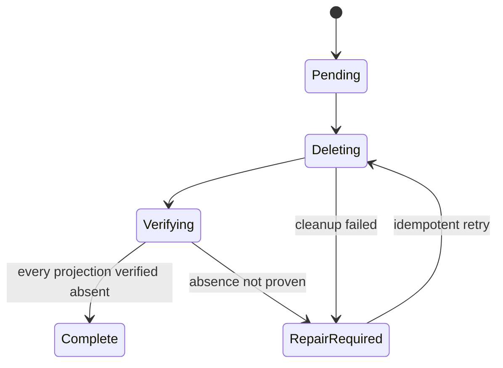

# 06 Governance & User Control — Implementation Plan

## Module Narrative

> "Users must be able to inspect, correct, retire, and truly erase what an agent remembers."

Memory without user control is a liability. This module gives users tools to
inspect and correct their profile, distinguishes lifecycle retirement from
privacy erasure, and restricts every operation to the authenticated user and
the calling agent's allowed scope.

Maps to: FR-011 (Governance), FR-012 (User Control), FR-015 (Least Privilege),
FR-018 (Sensitive Data), FR-019 (Persistence Policies).

---

## Status: 🔨 TO IMPLEMENT

---

## Already Built

| Capability | Where | Governance Use |
|------------|-------|----------------|
| Cosmos semantic memory | `SemanticMemoryStore` | Canonical preference documents partitioned by `/user_id` |
| Belief revision | `CosmosBeliefStore` | SCD Type 2 correction and authorized history |
| Provenance | `CosmosProvenanceStore` | Explains source, confidence, and confirmation history |
| Trust gating | `CosmosPromotionStore` | Prevents untrusted records entering recall |
| Scoped cleanup | `SemanticMemoryStore.reset()` | Demonstrates physical deletion, but is not a production erasure workflow |

**What's new:** user-facing control, category/role access boundaries, and a
verified erasure coordinator that cleans every configured serving projection.

---

## Four Different Lifecycle Operations

These terms are not interchangeable:

| Operation | Content Retained? | Active Recall? | Purpose |
|-----------|-------------------|----------------|---------|
| **Supersede** | Yes | New version only | Replace an outdated belief and preserve history |
| **Retire/deprecate** | Yes | No | Remove a belief from serving while retaining authorized audit history |
| **Expire** | No, after TTL | Until expiry policy applies | Time-based removal for eligible episodic/procedural records |
| **Erase** | No | No | Remove sensitive data from every configured serving path now |

Setting `valid_to`, changing `state`, filtering retrieval, or waiting for TTL
does not satisfy an erasure request.

---

## Notebook 01: `01_user_control.ipynb`

### Objective

Give a user four explicit tools: inspect, correct, retire, and erase. The demo
must show that retirement preserves content for authorized history while
erasure leaves only a content-free record that deletion occurred.

### New Cosmos Governance Layer

```python
class CosmosGovernanceStore:
    async def inspect(self) -> list[dict]: ...
    async def correct(self, category: str, new_value: str) -> dict: ...
    async def retire(self, record_id: str, reason: str) -> dict: ...

class ErasureCoordinator:
    async def erase(self, request: ErasureRequest) -> ErasureResult: ...
    async def retry(self, request_id: str) -> ErasureResult: ...
    async def verify(self, request_id: str) -> ErasureResult: ...
```

`CosmosGovernanceStore.correct()` composes the existing SCD Type 2 behavior and
marks the replacement as an authoritative user correction. `retire()` patches
the lifecycle state and reason. `ErasureCoordinator` is separate because
privacy deletion can span more than one store and cannot be one Cosmos patch.

### Agent Tools

| Tool | Purpose |
|------|---------|
| `show_my_memories` | Display current memories and governance metadata |
| `correct_memory` | Retire an incorrect version and create a trusted replacement |
| `retire_memory` | Exclude a record from active recall while retaining authorized history |
| `erase_memory` | Irreversibly remove a confirmed scope from all registered projections |
| `explain_belief` | Explain a retained belief's provenance and confidence |

A generic request such as "forget this" requires clarification between
retirement and irreversible erasure. `erase_memory` requires explicit user
confirmation and a precise scope: `record`, `category`, or `user`.

### Erasure Request and Result

```python
@dataclass
class ErasureRequest:
    request_id: str
    user_id: str
    scope_type: str       # record | category | user
    scope_value: str
    requested_by: str
    reason: str

@dataclass
class ErasureResult:
    request_id: str
    status: str           # pending | deleting | verifying | complete | repair_required
    projection_outcomes: list[dict]
```

The model never supplies or changes `user_id`; authenticated application context
binds it before tool execution.

### Projection Registry

Erasure uses adapters for every configured location that could serve the value:

| Adapter | Responsibility |
|---------|----------------|
| Semantic Cosmos adapter | Delete canonical records, raw preference text, vectors, and provenance fields |
| Episodic Cosmos adapter | Delete applicable source events when included in request scope |
| MAF session adapter | Remove applicable messages or invalidate affected persisted sessions and summaries |
| Cache adapter | Purge configured application and retrieval caches |
| AI Search adapter | Delete personal-memory projections only when such an index is configured |

The current Azure AI Search index contains shared corporate policies, not
personal memory. Its outcome is therefore `not_applicable`; the tutorial must
not claim that unrelated policy documents were deleted.

Each adapter implements deletion and absence verification. The registry makes
future serving projections discoverable instead of relying on a hard-coded list.

### Content-Free Tombstone

Erasure progress is stored in a separate Cosmos deletion-audit container,
partitioned by `/user_id`:

```json
{
  "id": "erase-request-id",
  "user_id": "E001",
  "scope_type": "record",
  "scope_reference": "opaque-record-id",
  "requested_by": "authenticated-user",
  "requested_at": "2026-09-16T10:00:00Z",
  "reason": "user_requested_erasure",
  "status": "complete",
  "projection_outcomes": [
    {"projection": "semantic-cosmos", "status": "verified_absent"}
  ],
  "completed_at": "2026-09-16T10:00:01Z"
}
```

The tombstone and repair payload must never contain memory text, evidence text,
an embedding, a generated summary, or a reconstructable hash of a low-entropy
value. This is an operational deletion audit, not belief history.

### Fail-Closed Workflow



If any configured adapter fails cleanup or verification, the result is
`repair_required`. The agent must report that deletion is incomplete rather
than saying the memory was forgotten.

### Demo Flow

1. Seed several memories, including a dietary restriction with provenance.
2. Inspect the current profile.
3. Correct an airline preference and show both SCD Type 2 versions in history.
4. Retire a seat preference and prove it is absent from recall but present in
   authorized history.
5. Ask to forget the dietary restriction; clarify and confirm irreversible
   erasure.
6. Erase it through all registered projections.
7. Show the content-free tombstone without reproducing the erased value.
8. Start a fresh session and verify the erased memory cannot be recalled.

---

## Notebook 02: `02_access_control.ipynb`

### Objective

Enforce user partitioning, role/category least privilege, and consent before
storing sensitive data. Governance operations must pass the same checks as
ordinary recall and writes.

### New Components

```python
class MemoryScopeMiddleware:
    def __init__(self, allowed_categories: list[str]): ...

class SensitivityDetector:
    async def check(self, content: str) -> dict: ...
```

User isolation is enforced by constructing stores with a fixed Cosmos
partition key. Category access is enforced before querying or mutating data,
not merely by filtering text returned to the model.

### Demo Flow

1. Create travel and expense agents with different allowed categories.
2. Verify each agent can retrieve only its allowed categories.
3. Submit a passport number and require consent before persistent storage.
4. Attempt a cross-category retirement and erasure; both are denied without
   disclosing the target value.
5. Attempt a cross-user operation; the bound `/user_id` prevents access.
6. Perform an authorized erase and verify its tombstone follows the same user
   and role boundaries.

---

## Validation Criteria

| Check | Expected Result |
|-------|-----------------|
| Correction | New trusted version; prior value retained as superseded history |
| Retirement | Hidden from active/vector recall; visible in authorized history |
| Erasure | Raw content, embedding, evidence, and configured projections absent |
| Tombstone | Records outcome without reproducing erased content |
| Partial failure | Returns `repair_required`, never success |
| Retry | Idempotent and completes only after verification |
| User isolation | Another partition cannot inspect or mutate the record |
| Category scope | An agent cannot govern categories outside its role |

---

## Reference

GoodMemory's forget integration suite is a reference for the cross-projection
test shape only; this tutorial does not depend on GoodMemory:
https://github.com/hjqcan/GoodMemory/blob/main/tests/integration/forget.api.test.ts

The tutorial demonstrates verifiable technical deletion semantics. It does not
claim legal or regulatory compliance. Backup retention, provider deletion SLAs,
and infrastructure snapshots remain production deployment responsibilities.

---

## Prerequisites

- Module 3 Cosmos lifecycle management and SCD Type 2 history
- Module 4 provenance and confidence-aware recall
- Module 5 lifecycle-aware retrieval and tool routing

## Outputs for Later Modules

- Privileged erasure boundary → Module 7 security
- Canary and failure-injection contract → Module 8 evaluation
- Scoped erasure propagation → Module 9 multi-agent memory
- Governance tools and coordinator → Module 10 unified agent