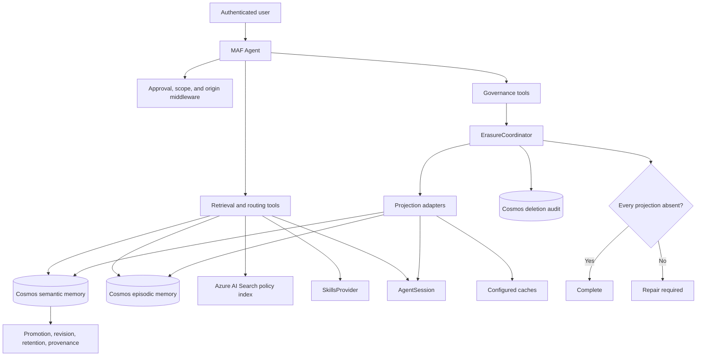

# 10 Unified Memory Agent — Implementation Plan

## Module Narrative

> "One agent that remembers, revises, routes, protects, and verifiably forgets."

This capstone composes the capabilities from Modules 2–9. It introduces no new
memory architecture; it proves that the Cosmos stores, MAF tools, middleware,
governance coordinator, and evaluation contracts work together.

---

## Status: 🔨 TO IMPLEMENT

## Notebook: `01_unified_memory_agent.ipynb`

### Builds On

| Module | Contribution |
|--------|--------------|
| 02 | Session, episodic, semantic, and procedural memory |
| 03 | `CosmosPromotionStore`, `CosmosBeliefStore`, `CosmosRetentionStore` |
| 04 | `CosmosProvenanceStore` and confidence-aware presentation |
| 05 | Lifecycle-aware retrieval and multi-store routing |
| 06 | Inspection, correction, retirement, `ErasureCoordinator` |
| 07 | Origin binding, authorization, and destructive-operation defenses |
| 08 | Quality, attack, isolation, and canary evaluation |
| 09 | Scoped handoff and multi-user isolation |

### Agent Construction

```python
assistant = Agent(
    client=client,
    name="TravelAssistant",
    instructions=UNIFIED_SYSTEM_PROMPT,
    tools=[
        search_flights,
        search_hotels,
        search_travel_policies,
        remember_belief,
        recall_beliefs,
        recall_past_events,
        explain_belief,
        belief_history,
        show_retention_scores,
        show_my_memories,
        correct_memory,
        retire_memory,
        erase_memory,
    ],
    context_providers=[skills_provider],
    middleware=[tool_approval, memory_scope, origin_enforcement],
)
```

Stores and tools are constructed with authenticated `user_id`; it is never a
model-controlled argument.

### Architecture



The Azure AI Search policy index is shared grounding, not a personal-memory
projection. It participates in erasure only if a future deployment explicitly
indexes personal data there.

### Capstone Scenario

#### Act 1: Build and Explain Memory

1. User provides travel preferences; the agent identifies and stores them.
2. User inspects the profile and asks why one belief is held.
3. Agent returns persisted provenance rather than generating a rationale.

#### Act 2: Route and Book

4. User requests a trip; the agent combines semantic preferences, procedural
   skills, policy grounding, and operational availability.
5. Agent stores the completed booking as an episodic event.

#### Act 3: Revise and Maintain

6. User moves city; SCD Type 2 supersedes city and airport beliefs.
7. A historical question retrieves the version valid at booking time.
8. Scheduled retention scoring deprecates low-value synthetic noise without
   treating eviction as privacy erasure.

#### Act 4: Defend

9. Inject an unsupported entitlement through tool output or another agent.
10. Origin ceiling and gated recall prevent it from influencing the booking.

#### Act 5: Retire and Erase

11. Retire a harmless preference and show that authorized history remains.
12. Store and retrieve a sensitive canary, then request irreversible erasure.
13. Inject one projection cleanup failure; the agent reports `repair_required`
    and does not claim the memory was forgotten.
14. Repair and retry the same request idempotently.
15. Create a fresh session and prove the canary is absent from every projection.
16. Display the content-free tombstone without reproducing erased content.

#### Act 6: Handoff and Isolation

17. Hand off minimum trip data to an expense agent.
18. Verify role scope, user partition isolation, and erased-value absence in the
    receiving agent's fresh session.

### Programmatic Validation

| Check | Expected |
|-------|----------|
| Current profile | Latest values only |
| Historical profile | Correct SCD Type 2 versions |
| Trust gate | Candidate attack absent from context |
| Routing | Correct memory tools invoked |
| Retention | Low-value records deprecated, not described as erased |
| Provenance | Stored source and confidence returned |
| Retirement | Hidden from active recall, retained in authorized history |
| Erasure failure | `repair_required` |
| Erasure completion | All registered projections verified absent |
| Canary recall after restart | `stale_or_erased_canary_recall_count == 0` |
| Tombstone leakage | No erased content or evidence |
| Multi-user isolation | Other user unchanged |

### Key Insight

The capstone succeeds only when memory behavior is observable and testable. A
fluent answer is not enough: current-state, provenance, authorization, deletion
outcomes, and every serving projection must agree.

---

## Prerequisites

- Modules 1–9 completed
- Cosmos semantic, episodic, and deletion-audit containers
- Azure AI Search policy index, Azure AI Foundry, and MAF configuration
- All erasure adapters registered for configured serving paths

## Deliverables

- One conversation-driven notebook demonstrating the complete lifecycle
- Updated architecture diagram
- Programmatic integration checks for every capability
- Failure-injection and canary-based verified-erasure acceptance test